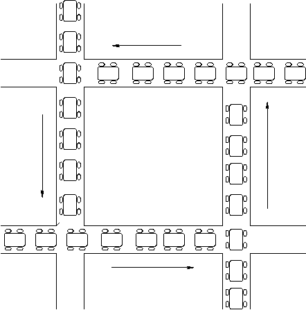
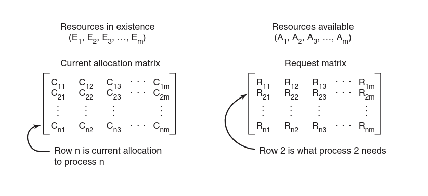

=========
Deadlocks
=========

Before introducing the contents of this book, a good review of the most
important notions on deadlocks is necessary. The contents of this chapter are
mostly based on chapter 6 of "Modern Operating Systems" by Andrew S. Tanenbaum
and Herbert Bos, Fourth Edition.

For many applications, a process needs exclusive access to several resources. A
*resource* can be of different type such as devices, data records, files, etc. A
resource can be *preemptable* if it can be taken away from the process owning it
with no ill effect, otherwise it is *nonpreemptable* (a Blu-ray CD cannot be
taken from one writing process to the other without it becoming malformed). A
set of processes is *deadlocked* if each process in the set is waiting for an
event that only another process in the set can cause. In most cases, the event
that each process is waiting for is the release of some resource currently
possessed by another member of the set; such deadlocks are called *resource
deadlocks*.

In general, deadlocks involve non-preemptable resources. The abstract sequence
of events required to use a resource is given below:

1. Request the resource

2. Use the resource

3. Release the resource

For example, this pseudocode shows a function that requests and releases a
semaphore.

.. code-block:: c

   typedef int semaphore;
   semaphore resource_1;

   void process_A(void) {
       down(&resource_1);
       use_resource_1();
       up(&resource_1);
   }

If the resource is not available when it is requested, the requesting process is
forced to wait.

An example deadlock is the following. Notice the order of how resources are
requested and try to think when a deadlock may happen:

.. code-block:: c

   semaphore resource_1;
   semaphore resource_2;

   void process_A(void) {
       down(&resource_1);
       down(&resource_2);
       use_both_resources();
       up(&resource_2);
       up(&resource_1);
   }

   void process_B(void) {
       down(&resource_2);
       down(&resource_1);
       use_both_resources();
       up(&resource_1);
       up(&resource_2);
   }

Deadlock Conditions
-------------------

Coffman et al. (1971) showed that four conditions must hold for there to be a
(resource) deadlock:

* *mutual exclusion condition*: each resource is either currently assigned to
  exactly one process or is available.

* *hold-and-wait condition*: processes currently holding resources that were
  granted earlier can request new resources.

* *non-preemption condition*: resources previously granted cannot be forcibly
  taken away from a process. They must be explicitly released by the process
  holding them.

* *circular wait condition*: there must be a circular list of two or more
  processes, each of which is waiting for a resource held by the next member of
  the chain.

Deadlock Modeling
-----------------

Holt (1972) showed how these four conditions can be modeled using directed
graphs. The graphs have two kinds of nodes: processes and resources. A directed
arc from a resource node to a process node means that the resource has
previously been requested by, granted to, and is currently held by that process.
A directed arc from a process to a resource means that the process is currently
blocked waiting for that resource. A cycle in the graph means that there is a
deadlock involving the processes and resources in the cycle.

In general, four strategies are used for dealing with deadlocks:

1. Ostrich algorithm: Stick your head in the sand and just ignore the problem.
   Maybe if you ignore it, it will ignore you.

2. Detection and recovery: Let them occur, detect them, and take actions.

3. Dynamic avoidance by careful resource allocation.

4. Prevention, by structurally negating one of the four conditions.

Deadlock Detection
------------------

Let us analyze a situation with only one resource of each type (one scanner, one
plotter, one tape drive, etc.). To detect a deadlock, we can build the directed
graph of processes and resources as explained earlier and check for a cycle (via
a DFS or BFS).

Let us now consider the more general case with multiple copies of the same
resource, which requires a different approach. We will now present a
matrix-based algorithm for detecting deadlock among :math:`n` processes,
:math:`P_1` through :math:`P_n`.

* Let the number of resource classes be :math:`m`, with :math:`E_1` resources of
  class :math:`1`, :math:`E_2` resources of class :math:`2`, and generally,
  :math:`E_i` resources of class :math:`i` (:math:`1 \le i \le m`). :math:`E` is
  the *existing resource vector*. It gives the total number of instances of each
  resource in existence. For example, if class :math:`1` is tape drives, then
  :math:`E_1=2` means the system has two tape drives.

* At any instant, some of the resources are assigned and are not available. Let
  :math:`A` be the *available resource vector*, with :math:`A_i` giving the
  number of instances of resource :math:`i` that are currently available (i.e.,
  unassigned). If both of our two tape drives are assigned, :math:`A_i` will be
  :math:`0`.

* Let :math:`C` be the *current allocation matrix*. The :math:`i`-th row of
  :math:`C` tells how many instances of each resource class :math:`P_i`
  currently holds. Thus, :math:`C_{ij}` is the number of instances of resource
  :math:`j` that are held by process :math:`i`.

* Let :math:`R` be the *request matrix*. Similarly to :math:`C`, :math:`R_{ij}`
  is the number of instances of resource :math:`j` that :math:`P_i` wants.

These four data structures are shown in the following figure.

An important invariant holds for these four data structures. In particular,
every resource is either allocated or is available. This observation means that:

.. math::

   \sum_{i=1}^n C_{ij} + A_{j}= E_j

In other words, if we add up all the instances of the resource :math:`j` that
have been allocated and to this add all the instances that are available, the
result is the number of instances of that resource class that exist.

The deadlock detection algorithm is based on comparing vectors. Let us define
the relation :math:`A \le B` on two vectors :math:`A` and :math:`B` to mean that
each element of :math:`A` is less than or equal to the corresponding element of
:math:`B`. Mathematically, :math:`A \le B` holds if and only if :math:`A_i \le
B_i` for :math:`1 \le i \le m`.

Each process is initially said to be unmarked. As the algorithm progresses,
processes will be marked, indicating that they are able to complete and are thus
not deadlocked. When the algorithm terminates, any unmarked processes are known
to be deadlocked. This algorithm assumes a worst-case scenario: all processes
keep all acquired resources until they exit.

The deadlock detection algorithm can now be given as follows:

1. Look for an unmarked process, :math:`P_i`, for which the :math:`i`-th row of
   :math:`R` is less than or equal to :math:`A`.

2. If such a process is found, add the :math:`i`-th row of :math:`C` to
   :math:`A`, mark the process, and go back to step 1.

3. If no such process exists, the algorithm terminates.

When the algorithm finishes, all the unmarked processes, if any, are deadlocked.
The key is in the first step: it means that if a process wants more resources
than are available, then it is deadlocked. If a process is not considered
deadlocked, then its used resources are added to the available ones. This
algorithm is non-deterministic because processes can run in any order, but the
result is always the same. It is the same because step 2 runs on all unmarked
processes, instead of just checking a process and considering it as deadlocked
immediately: if process :math:`X` requests too many resources, it is skipped and
another one is tested, which may add resources to :math:`A` so when :math:`X`
will be tested again with more resources; on step 3, there are processes which
take more resources than the total available ones.

Through this algorithm we know if a deadlock exists, but when do we look for
these, considering that it may be an expensive operation? It may be checked
every time a resource request is made, or every :math:`k` minutes, or perhaps
only when the CPU utilization has dropped below some threshold.

Deadlock Recovery
-----------------

What do we do after detecting a deadlock to recover the system?

* *preemption*: in some cases, it may be possible to temporarily take a resource
  away from its current owner and give it to another process, but this depends
  on the nature of the resource. Recovering this way is frequently difficult or
  impossible.

* *rollback*: if the system designers and machine operators know that deadlocks
  are likely, they can arrange to have processes checkpointed periodically. When
  a deadlock is detected, a process that owns a needed resource is rolled back
  to a point in time before it acquired that resource by starting at one of its
  earlier checkpoints.

* *killing processes*: the crudest but simplest way to break a deadlock is to
  kill one or more processes. One possibility is to kill processes in the cycle
  until the cycle is broken. Alternatively, a process is carefully chosen
  because it is holding resources that some process in the cycle needs. When
  possible, it is best to kill a process that can be rerun from the beginning
  with no ill effects.

Deadlock Avoidance
------------------

When a process asks for a resource, the system may be able to decide whether
granting a resource is safe or not and make the allocation only when it is safe.
In this section we will examine algorithms that can always avoid deadlock by
making the right choice all the time, but only if certain information is
available in advance.

A state is said to be *safe* if there is some scheduling order in which every
process can run to completion even if all of them suddenly request their maximum
number of resources immediately. To do this we need to know how many resources
any process has, how many do they want at most, and the number of free
resources. This is called the *Banker's Algorithm* (Dijkstra, 1965): the first
process gets its maximum resources, then frees them, gets popped from the queue,
and the algorithm is run again until there are no more processes in the queue.
If the first process cannot get its resources, then we are in a non-safe state
and we cancel the allocation. Note that an unsafe state does not have to lead to
a deadlock, but because it might it gets discarded. This can be generalized to
multiple resources.

In practice, "it is essentially useless" because processes rarely know in
advance what their maximum resource needs will be. Therefore, in practice, few,
if any, existing systems use the banker's algorithm for avoiding deadlocks. Some
systems use heuristics; for instance, networks may throttle traffic when buffer
utilization reaches higher than, say, 70%, estimating that the remaining 30%
will be sufficient for current users to complete their service and return their
resources.

Deadlock Prevention
-------------------

Since we have seen that deadlock avoidance is not useful in practice, we can try
to negate one of the four conditions stated by Coffman et al. If we can ensure
that at least one of these conditions is never satisfied, then deadlocks will be
structurally impossible (Havender, 1968).

* *attacking mutual exclusion*: we could assign a resource so that it is not
  mutually exclusive, such as making it read-only. But this can only be applied
  in some cases, as writers would have to synchronize with each other.

* *attacking hold-and-wait*: we could prevent processes from waiting for more
  resources by requesting all of them at the start of the execution. This has
  two problems: first, most processes don't know how many resources they will
  need beforehand; second, this would lead to holding many resources that are
  not used for most of the process, which is bad.

* *attacking no-preemption*: we can take away the resource from a process by
  force. But this is not always possible; for example, if a printer is printing
  something, and we assign its output to a different process, then the printed
  page will look corrupted as it will print some parts of the first process and
  some other parts of the other process.

* *attacking circular wait*: we can say that a process is entitled to hold only
  a single resource at any moment, and it must release it before getting a
  second one. This is not possible in many situations. Another way to avoid the
  circular wait is to provide a global numbering of all the resources. Now the
  rule is: processes can request resources whenever they want to, but all
  requests must be made in numerical order. If the order is: printer, plotter,
  tape drive, then a process may request first a printer and then a tape drive,
  but it may not request first a plotter and then a printer. With this rule, the
  resource allocation graph can never have cycles. Alternatively, any process
  could request only a resource lower than what it is already holding. Although
  numerically ordering the resources eliminates the problem of deadlocks, it may
  be impossible to find an ordering that satisfies everyone as the number of
  potential resources may be quite big.

Synchronization Primitives
--------------------------

TODO: the producer-consumer problem

TODO: semaphores

TODO: mutexes

TODO: futexes

TODO: monitors

Classic IPC Problems
--------------------

Here are some classic problems about synchronization methods.

The Dining Philosophers
~~~~~~~~~~~~~~~~~~~~~~

The problem can be stated in the following way. Five philosophers are seated
around a circular table. Each philosopher has a plate of spaghetti. The
spaghetti is so slippery that a philosopher needs two forks to eat it. Between
each pair of plates is one fork. The life of a philosopher consists of
alternating periods of eating and thinking. When a philosopher gets sufficiently
hungry, she tries to acquire her left and right forks, one at a time, in either
order. If successful in acquiring two forks, she eats for a while, then puts
down the forks, and continues to think. The key question is: Can you write a
program for each philosopher that does what it is supposed to do and never gets
stuck?

We could tell each philosopher to wait for the fork on his right, and then on
his left. This is problematic because it may happen that each philosopher picks
up the fork on his right, and, since they are in a circle, one's right fork is
another's left fork, and they go into deadlock. If all philosophers fail to make
any progress, it is called *starvation*. A solution could be to wait a random
amount of time and try again, which would work in practice. Indeed this is how
Ethernet does it when multiple writers are trying to write to the same medium,
but for other applications a more reliable solution that does not depend on
randomness would be preferred. We could have a global lock for picking up forks,
which would solve deadlocks, but would degrade performance since only one
philosopher can be eating at an instant.

The solution that allows the maximum parallelism for an arbitrary number of
philosophers uses an array of states and a semaphore for each philosopher. Each
philosopher can either be in the eating, thinking, or hungry (trying to acquire
forks) state. Hungry philosophers can block if the needed forks are busy.

.. code-block:: c

   #define N         5
   #define LEFT      (i+N-1)%N
   #define RIGHT     (i+1)%N
   #define THINKING  0
   #define HUNGRY    1
   #define EATING    2

   typedef int semaphore;
   int state[N];
   semaphore mutex = 1;  // guards "state", only one philosopher can modify it
   semaphore s[N];

   void philosopher(int i) {
     while (TRUE) {
       think();
       take_forks(i);
       eat();
       put_forks(i);
     }
   }

   void take_forks(int i) {
     down(&mutex);
     state[i] = HUNGRY;
     // take fork
     test(i);
     up(&mutex);
     // block if forks were not acquired, we will be
     // unblocked by the philosopher when he is done "put_forks"
     down(&s[i]);
   }

   void put_forks(int i) {
     down(&mutex);
     state[i] = THINKING;
     // See if neighbors can now eat
     // wakes up neighbours
     test(LEFT);
     test(RIGHT);
     up(&mutex);
   }

   // guarded by "mutex"
   void test(int i) {
     // check left and right
     if (state[i] == HUNGRY
       && state[LEFT] != EATING
       && state[RIGHT] != EATING) {
       state[i] = EATING;
       up(&s[i]);
     }
   }

Readers and Writers Problem
~~~~~~~~~~~~~~~~~~~~~~~~~~~

Imagine, for example, an airline reservation system, with many competing
processes wishing to read and write it. It is acceptable to have multiple
processes reading the database at the same time, but if one process is updating
(writing) the database, no other processes may have access to the database, not
even readers. How do you program the readers and writers? The following is one
solution:

.. code-block:: c

   int rc = 0;          // # of processes reading or writing to
   typedef int semaphore;
   semaphore mutex = 1; // guards rc
   semaphore db = 1;    // guards access to the database

   void reader(void) {
     while(TRUE) {
       down(&mutex);
       rc = rc + 1;
       // If this is the first reader, lock the db
       if (rc == 1) down(&db);
       up(&mutex);
       read_data_base();
       down(&mutex);
       rc = rc - 1;
       // if this is the last reader, unlock the db
       if (rc == 0) up(&db);
       up(&mutex);
       use_data_read();
     }
   }

   void writer(void) {
     while (TRUE) {
       think_up_data();
       down(&db);    // exclusive access when no readers are there
       write_data_base();
       up(&db);
     }
   }

This solution allows multiple readers to happen at the same time, and readers
will continue to have access to the resource as long as they exist. This may
lead to starvation for the writer. Alternatively, we could write this solution
so that, when a reader arrives and a writer is waiting, the reader is suspended
behind the writer instead of being admitted immediately; the disadvantage here
is that it achieves less concurrency.

Linux Lockdep
-------------

Every mutex calls lockdep's `__lock_acquire()` when locked, and
`__lock_release()` when unlocked. There is a `__bfs()` function that should be
investigated, also a `check_deadlock()` function, called by `validate_chain()`,
called in `__lock_acquire()`. This `validate_chain` also calls `__bfs()`.

TODO
