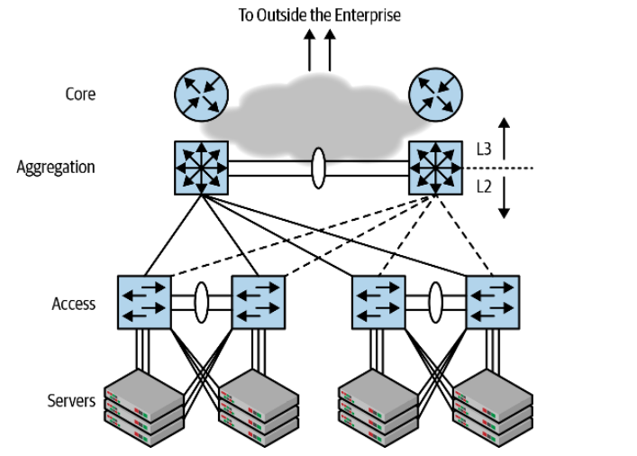
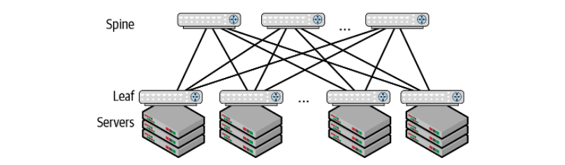
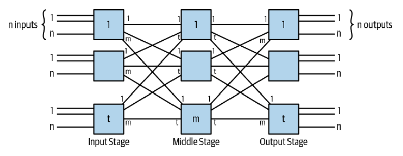

Cloud Native Data Center Networking
===================================

Networking needs have evolved over time. At the very beginning, most
applications where monolithic and required modest networking infrastructure,
where most of the networking was proprietary and running on a mainframe.
Subsequently, the next generation of application was based on the client-server
architecture characterized by the rise of the local area network (LAN). Then
other evolutions happened, such as TCP/IP, Ethernet, server virtualisation,
Linux. A new network design was needed.

Access Aggregation Core
-----------------------

At the beginning of the century, data centers began to use a network designed
called `access-aggregation-core`, often shortened to access-agg-core or just
access-agg.

The endpoints or compute nodes are attached to `access` switches, which are
connected to `aggregation` switches, also called `distribution` switches, which
perform L2 (bridging) and L3 (routing) operations. Note that the directions of
the pictures are relevant as they are often used by convention, where north
means that the compute is going outside the network, and east-west means that
the information is moving on the same level. L2 bridges are easy to setup as
they automatically build the lookup table, although this takes times since the
switch has to flood the network when he does not know where an end point is
located (although this is somewhat mitigated via the use of VLANs, creating
additional problems), and it requires that no loops are present which may
require the Spanning Tree Protocol (meaning that any point cannot use more than
one link).

Clos
----

The structure of the new world uses the Clos topology, named after one of its
investors, Charles Clos.

The pictures shows two layers of switches, one called the `spine` and the other
called the `leaf`. Hence, the layout is also commonly called a `leaf-spine`
topology. Every leaf is connected to every spine node. The spines connect the
leaves to one another, and the leaves connect the servers to the network. The
leaf is often called `top of rack` (ToR) switch.

This topology produces a high-capacity network, because there are more than two
paths between any two servers. Adding more spines increases the available
bandwidth between leaves. Adding more links between a leaf and a spine is not
recommended to achieve this goal. The spines serve a single purpose: to connect
the different leaves; computer endpoints are never attached to spines. The
spines do not provide any other services: all functionality is pushed to the
edges of the network, the leaves and the servers themselves, rather than being
provided by the center, represented by the spines.

Clos grows in a very consistent way thanks to having what's called a `scale-out`
architecture: you increase the amount of work supported by the network by
adding more leaves and servers. The spines are then used only to scale the
available bandwidth between the edges.

Instead of using bridging which requires Spanning Tree Protocol, Clos uses
routing across racks via a more modern network virtualisation solution such as
the Virtual eXtensible Local Area Network (VXLAN). More than two spines are
supported by something called Equal-Cost Multipath (ECMP) routing which allows a
packet to be forwarded along any of the available equal-cost paths.

Assuming we're using :math:`n`-port switches for both leaf and spine, and
assuming a 1:1 oversubscription (ratio between uplink and downlink bandwidth),
the maximum number of servers that can be connected in the Clos topology shown
in the picture is :math:`n^2 / 2`.

TODO: Page 25
